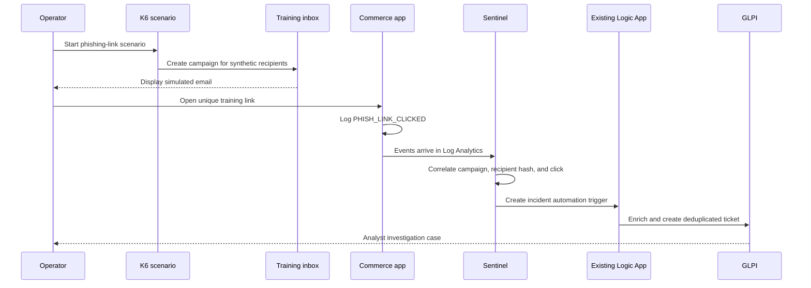

# Phishing email SOC scenario plan

## Goal

Add a controlled phishing-link exercise to the existing Secure Commerce SOC lab. A learner reviews a simulated message, follows its training link, and investigates the resulting Sentinel incident and GLPI ticket.

The first version uses an in-app training inbox. It sends no external email, collects no passwords, and reuses the current Azure monitoring and ticketing path.

## Reuse the deployed platform

- `secure-commerce-dev-app` hosts the simulated inbox and safe landing page.
- `ContainerAppConsoleLogs_CL` in `secure-commerce-dev-law` stores structured events.
- Microsoft Sentinel evaluates the scenario and creates an incident.
- `secure-commerce-dev-soc-glpi-playbook` enriches the incident and creates a GLPI ticket.
- `ticket.platf0rm.site` is the analyst work queue.

The existing SOC architecture and bounded K6 conventions are documented in [SOC architecture](soc/architecture.md) and [K6 runbook](soc/k6.md).

## Architecture

```mermaid
flowchart LR
    subgraph Lab[Controlled training boundary]
        K[K6 scenario runner<br/>1 VU; at most 5 synthetic recipients]
        I[Training inbox preview<br/>new app feature]
        C[Safe training landing page<br/>no password field]
        K -->|create tagged campaign| I
        I -->|learner opens message and clicks link| C
    end

    C -->|structured PHISH events| APP[Existing commerce Container App]
    APP --> LAW[Existing Log Analytics workspace<br/>ContainerAppConsoleLogs_CL]
    LAW --> SENT[Existing Sentinel<br/>phishing analytics rule]
    SENT --> PLAY[Existing incident automation<br/>Logic App]
    PLAY --> GLPI[Existing GLPI<br/>ticket.platf0rm.site]
```

The inbox preview contains the message subject, displayed sender, body, and a unique link to a lab route such as `/training/phish/{opaque-token}`. The token is short-lived and single-use. The landing page records a click and then shows a training debrief. It has no credential form. If a later exercise needs to model an attempted credential submission, K6 emits a synthetic action event without sending or storing a password.

## Learner-to-ticket sequence

## Event and detection design

Use the existing scenario correlation fields and JSON logging shape. Proposed event types are:

| Event | Meaning |
|---|---|
| `PHISH_SIM_CREATED` | A tagged campaign and training message were prepared. |
| `PHISH_LINK_CLICKED` | A learner followed the campaign's training link. |
| `PHISH_REPORTED` | A learner used the simulated report-phishing action. |
| `PHISH_SIMULATED_SUBMISSION` | Optional synthetic event indicating an attempted form action; no credential value is sent. |

Each event should include `simulation_id`, `request_id`, `event_type`, `message_id_hash`, `email_hash`, `timestamp`, `source_ip`, and the safe route/status fields available for that action. Never log raw recipient addresses, the opaque link token, message authentication tokens, or passwords. Use the app's observed source address and retain the existing private/unknown handling.

Add a Sentinel scheduled rule under `infra/modules/soc/queries` and register it in `infra/modules/soc/locals.tf`. Correlate only events with a valid simulation ID and message hash. A click should create a low or medium severity training incident; a report event should be included as positive user action. A click alone is not evidence of account compromise. Correlate any actual authentication event separately before raising the assessment.

Extend the existing playbook evidence query and GLPI description with the phishing-specific fields. Keep its current incident validation, Key Vault secret retrieval, deduplication, and session cleanup. Do not add automatic account disablement or password resets to this exercise.

## Example GLPI ticket

**Title:** Phishing simulation: training link clicked
**Severity:** Medium
**Asset:** Commerce API / `secure-commerce-dev-app`
**Classification:** Controlled training simulation

**Summary:** A synthetic recipient followed a unique link in a simulated email. This event records the click only; it does not establish credential exposure or account compromise.

**Evidence:** Campaign ID, recipient hash, displayed sender and subject, link host/path, click time, observed source or `unknown`, and any matching authentication events.

**Analyst actions:**

1. Review the simulated message and validate its sender, subject, and destination.
2. Confirm whether the learner reported it, clicked it, or both.
3. Check for a related successful sign-in or other account activity in the same time window.
4. Record whether the activity stayed within the training flow and document the disposition.

## Delivery stages

1. **Training inbox and click route:** Add the preview and landing-page behavior to the existing app; emit correlated, privacy-safe events.
2. **Bounded scenario:** Add a K6 scenario following the existing one-VU and synthetic-identity conventions, capped at five recipients and guarded by the existing kill switch.
3. **Detection and ticket enrichment:** Add the Sentinel rule and the phishing-specific evidence mapping in the existing GLPI playbook.
4. **End-to-end verification:** Confirm one run produces matching Log Analytics events, one Sentinel incident, one GLPI ticket, and a duplicate-free replay.

## Optional live-email extension

If a later exercise needs delivery into a real mailbox, add Azure Communication Services Email only for an owned, verified sender domain and an explicit allowlist of consenting test recipients. Keep campaign IDs and safe links; do not collect credentials. This requires a separate Email Communication resource and is usage-priced. Log Analytics ingestion can also incur charges, so retain the existing small recipient and event caps. See Microsoft's [ACS Email overview](https://learn.microsoft.com/en-us/azure/communication-services/concepts/email/email-overview) and [Azure Monitor resource log guidance](https://learn.microsoft.com/en-us/azure/azure-monitor/platform/tutorial-resource-logs).
