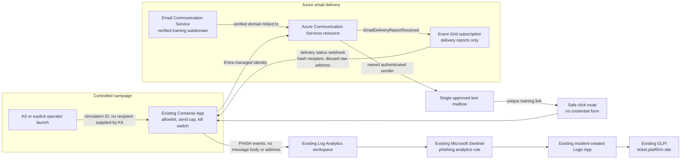

# Cloud phishing email SOC scenario plan

## Goal and boundaries

Send a small, controlled phishing-awareness exercise to one explicitly approved test mailbox and follow the message through delivery, link interaction, Sentinel, and GLPI. This is an infrastructure plan; it does not send email.

The campaign sender uses a domain the lab owner controls, and the recipient is held in private Azure configuration rather than this repository. The first version has a one-address allowlist, a maximum of three messages per campaign, and a default-off send switch. It collects no passwords, uses no attachments, and does not impersonate a third-party brand.

## Reuse the deployed platform

- `secure-commerce-dev-app` hosts the guarded campaign API, email-event receiver, and safe click landing page.
- Its existing managed identity authenticates to Azure services; grant only the required email-send role at the Communication Services resource scope.
- `secure-commerce-dev-law` and `ContainerAppConsoleLogs_CL` hold the correlated application events.
- Microsoft Sentinel evaluates the phishing rule and creates an incident.
- `secure-commerce-dev-soc-glpi-playbook` enriches the incident and creates a GLPI ticket.
- `ticket.platf0rm.site` is the analyst work queue.

The existing SOC architecture and bounded K6 conventions are documented in [SOC architecture](soc/architecture.md) and [K6 runbook](soc/k6.md).

## Cloud architecture



### Azure resources and configuration

1. **Email Communication Service:** Create the Email Communication resource in the existing development resource group.
2. **Verified sender domain:** Provision a dedicated subdomain such as `training.platf0rm.site`. Add the TXT ownership record and the SPF and DKIM records shown by Azure to the authoritative DNS provider. Keep existing apex mail records intact. Use a sender such as `security-training@training.platf0rm.site`.
3. **Communication Services resource:** Create or reuse a Communication Services resource and link the fully verified email domain to it.
4. **Sender identity:** Use the existing Container App managed identity with Microsoft Entra authentication. Scope its email-sending permission to the Communication Services resource; do not put ACS keys or connection strings in GitHub or Terraform variables.
5. **Delivery reports:** Add an Event Grid subscription for `Microsoft.Communication.EmailDeliveryReportReceived` to the app's protected webhook. Validate Event Grid subscription handshakes, deduplicate event IDs, hash the recipient immediately, and avoid logging the raw event payload.
6. **Application guardrails:** Keep the allowed recipient in private app configuration, set `PHISH_SEND_ENABLED=false` by default, cap sends at three per campaign, require a simulation ID, and fail closed when the recipient or cap check fails. K6 can start a tagged run but cannot provide an arbitrary destination address.

Azure Communication Services requires custom-domain ownership verification and SPF/DKIM configuration before sending from that domain. Microsoft documents the domain and DNS setup in [Add custom verified email domains](https://learn.microsoft.com/en-us/azure/communication-services/quickstarts/email/add-custom-verified-domains). ACS can authenticate through Microsoft Entra ID; use the Container App identity rather than a stored key where the selected Email SDK supports it ([send email quickstart](https://learn.microsoft.com/en-us/azure/communication-services/quickstarts/email/send-email)).

## Message and event flow

```mermaid
sequenceDiagram
    participant Operator
    participant K6 as K6 scenario
    participant App as Existing Container App
    participant ACS as Communication Services Email
    participant Mailbox as Approved test mailbox
    participant EG as Event Grid
    participant LA as Log Analytics
    participant Sentinel
    participant GLPI

    Operator->>K6: Start a tagged, bounded campaign
    K6->>App: Request campaign; no address in request
    App->>App: Check feature flag, allowlist, cap, and simulation ID
    App->>ACS: Send from verified training domain using managed identity
    ACS->>Mailbox: Deliver training message
    ACS-->>EG: Email delivery report
    EG->>App: Delivery status event
    Mailbox->>App: Learner follows unique training link
    App->>App: Log delivery and click events with recipient hash
    App->>LA: Structured PHISH events
    LA->>Sentinel: Scheduled detection query
    Sentinel->>GLPI: Existing incident automation creates case
```

The email link leads to a short-lived training landing page on the existing app. The page records the click and displays a debrief; it has no credential form. The app route is the authoritative click signal. Leave ACS engagement/open tracking off for the first version to avoid extra tracking and duplicate click signals.

## Telemetry and detection

Proposed event types:

| Event | Meaning |
|---|---|
| `PHISH_EMAIL_REQUESTED` | A guarded campaign requested a send. |
| `PHISH_EMAIL_DELIVERED` | ACS reported a delivery status for the message. |
| `PHISH_LINK_CLICKED` | The recipient followed the unique training link. |
| `PHISH_REPORTED` | The recipient used the campaign's safe report/debrief action. |

Include `simulation_id`, `request_id`, `event_type`, a hashed message identifier, a hashed recipient identifier, timestamp, delivery status, safe route/status fields, and the observed source IP where available. Event Grid delivery reports contain a recipient address; hash it in the receiver and discard the raw address before writing to application logs. Do not log the email body, link token, raw address, passwords, or ACS credentials.

Add a scheduled Sentinel rule under `infra/modules/soc/queries` and register it in `infra/modules/soc/locals.tf`. Trigger an incident on a matching `PHISH_LINK_CLICKED` or `PHISH_REPORTED` event, correlated to a delivered message and valid simulation ID. A click alone is not evidence of account compromise. Check for separate successful authentication or other application activity before escalating the finding.

Extend the existing Logic App evidence query and GLPI description with campaign ID, sender, subject, recipient hash, delivery status, safe link host/path, click time, observed source or `unknown`, and matching authentication events. Preserve its current incident validation, Key Vault secret retrieval, deduplication, and session cleanup. Do not automatically disable accounts or reset passwords for this simulation.

## Example GLPI case

**Title:** Phishing simulation: training link clicked
**Severity:** Medium
**Asset:** Commerce API / `secure-commerce-dev-app`
**Classification:** Controlled awareness exercise

**Summary:** A test mailbox received a training message and followed its unique link. Delivery status and click telemetry are available. The click alone does not establish credential exposure or account compromise.

**Evidence:** Campaign ID, sender and subject, recipient hash, ACS delivery status, link host/path, click time, observed source or `unknown`, and any related authentication events.

**Analyst actions:**

1. Review the message sender, subject, and destination.
2. Confirm the delivery and link-click timeline.
3. Check for related successful sign-ins or other application activity.
4. Record whether the activity stayed within the exercise and document the disposition.

## Delivery stages

1. **Sender-domain setup:** Verify the dedicated subdomain and SPF/DKIM records; confirm the existing apex DNS records remain intact.
2. **Guarded sender:** Add ACS resources, managed-identity access, private one-address allowlist, default-off switch, and per-campaign send cap.
3. **Delivery and click telemetry:** Route delivery reports to the app, add the safe landing page, and emit privacy-filtered events to the existing workspace.
4. **Detection and ticketing:** Add the Sentinel query and phishing-specific evidence enrichment to the current Logic App.
5. **Bounded verification:** Start with a single explicitly approved test message; verify ACS delivery status, click telemetry, one Sentinel incident, one GLPI ticket, and duplicate-free replay before using the three-message cap.

## Limits and cost

ACS delivery reports distinguish outcomes such as delivered, bounced, quarantined, or failed. “Delivered” means handed to the destination mail server; it does not guarantee inbox placement or that the recipient read the message. The target is a personal Hotmail mailbox, so this lab cannot see that mailbox's Microsoft Defender or Exchange investigation data. Its visibility is limited to ACS delivery events and interactions with the lab's own link endpoint. See [ACS email events](https://learn.microsoft.com/en-us/azure/event-grid/communication-services-email-events).

Email sending is usage-priced, and Log Analytics ingestion can also incur charges. Check current Azure pricing and the subscription credit before enabling sends; the resource creation itself does not make delivery free. Keep the recipient and volume caps in place. ([ACS Email overview](https://learn.microsoft.com/en-us/azure/communication-services/concepts/email/email-overview), [Azure Monitor resource log guidance](https://learn.microsoft.com/en-us/azure/azure-monitor/platform/tutorial-resource-logs))
