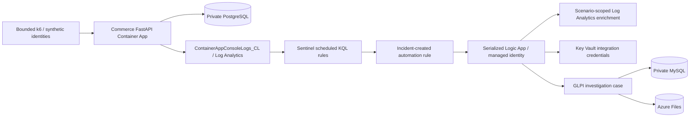

# SOC lab architecture and handover

## Deployed resources

- Subscription: `43adc2c2-0fd5-4474-aa8a-9f32f541e4b7`.
- Tenant: `cdd8b4e5-ab12-4d43-a01d-0e70523c17ac`.
- Resource group: `secure-commerce-dev-rg` (UK South).
- Commerce: <https://shop.platf0rm.site>; resource `secure-commerce-dev-app`.
- Workspace: `secure-commerce-dev-law`;
  customer ID `a2d52d68-fcce-47a5-bcfe-e7236b57da79`.
- Workflow: `secure-commerce-dev-soc-glpi-playbook`.
- Cases: <https://ticket.platf0rm.site>.
- Vault: `secure-commerce-dev-43ad`. The workflow reads
  `soc-glpi-api-username`, `soc-glpi-api-password`, and `soc-glpi-app-token`.
  Do not print these values or export Logic App signed output URLs.

Deployment, execution and verification records are in [scenario progress](scenario-progress.md)
and [sanitized evidence](evidence/). Eight live cases (seven incidents 66–72
and supplemental incident 73) were created automatically and replay-tested.
Image build `db4` published
`securecommercedev43adc2acr.azurecr.io/secure-commerce:soc-complete-20261101-0230`;
the application runs revision `secure-commerce-dev-app--0000003`.

## Detection and case creation

Nine enabled commerce rules evaluate every five minutes over fifteen minutes.
They require validated scenario and request IDs, deliberately separating this
training suite from an untagged production intrusion-detection system.
Authentication, spraying, successful authentication after same-account failures,
registration rejections, denied admin probes, admin directory reads, suspicious
requests, rate controls and API volume share normalization templates.

Distinct request counting prevents HTTP completion records from doubling security
events. Scenario ID and alert display name group overlapping alerts into one
incident over five hours. Global commerce suppression is disabled; never disable
all detections to make a test pass. Preserve open incidents while verifying
repeat evaluations.

The incident-created automation invokes the existing Logic App. Trigger concurrency
is one. Workspace/incident validation precedes credential access; enrichment is
restricted to the actual alert scenario and observation window. Missing correlation
produces `Unavailable`, never unrelated evidence. Ticket searches match the GUID
and exact legacy incident-number boundaries. Failed searches fail closed. Ticket
POSTs have no automatic retry; replay rechecks the incident before creation.
Managed-identity secret actions and GLPI authentication actions secure inputs and
outputs. Sessions are closed after processing.

Tickets contain short HTML sections, severity, actual UTC windows, asset,
correlation ID, the reliable observed source (or `unknown`/multiple fallback),
and investigation links. They do not contain findings or raw logs. The workspace
link is the tenant-aware resource overview route, not `LogsBlade`. Analysts use
[the runbook](runbook.md) and document their own disposition in GLPI.

## Source attribution and scope

Uvicorn runs with `--no-proxy-headers`. Only explicitly trusted immediate proxy
peers permit use of the rightmost forwarded address. Private, loopback and
`100.64.0.0/10` addresses are not attributed as public sources. Fresh runs observed
`82.9.130.188`, independently matching the runner egress. No source addresses or
locations were spoofed; geography remains unknown.

There is no suitable VM, Windows/Sysmon feed, Entra sign-in/MFA feed or EDR connector.
Graph sign-in access fails because the tenant lacks premium licensing.
Cloud-change detection is disabled until an approved AzureActivity export exists.
Telemetry-gap detection is disabled because the commerce app legitimately scales
to zero. Existing registry, application and platform diagnostics remain intact.

## Operational handover

1. Authenticate Azure CLI to the tenant/subscription above; use existing permissions.
   GitHub OIDC deployment uses the configured deployment service principal.
2. Run local checks documented in [k6.md](k6.md), then use `soc/validate.py run`.
   Do not repeatedly attack the same locked identity. Keep at least 65 seconds
   between independent authentication runs.
3. Use `soc/validate.py verify SCENARIO_ID --wait 900`. Allow ingestion and Sentinel
   scheduling delay. Inspect failed workflow actions rather than creating a case
   directly. Evidence files must show actual matching alert, incident, run and ticket.
4. For a synthetic administrator, use the protected maintenance CLI
   `python -m app.lab_accounts` through Container Apps exec. It fetches a dedicated
   `soc-lab-*` credential using the existing app managed identity, refuses non-lab
   accounts and does not change existing mismatched identities. The current account
   is `soc-admin-training@platf0rm.site`; password secret `soc-lab-admin-password`.
5. Back up remote Terraform state before imports or deployment. Supply real existing
   PostgreSQL/JWT/GLPI values from Key Vault through protected environment variables.
   Never use placeholder secrets for a full or Container App plan. Inspect a normal
   refreshed plan; never conceal drift with `refresh=false`.
6. Preserve cases and analyst notes. Test idempotency by resubmitting a **real**
   workflow trigger history, not by injecting a manufactured Sentinel incident.
   Incident 64 was replayed twice successfully with no case or follow-up changes.

Initial state/workflow backups and plan logs are protected outside Git in `/tmp`.
The existing GLPI AcrPull assignment was imported, not duplicated. Consumption
workload profiles are declared to match existing Azure resources rather than
removing them. Terraform manages workflow actions and analytics rules; application
CD owns the immutable image through the existing lifecycle exception.

The current remote Terraform state backup is
`backups/secure-commerce-dev-final-20261101T0326.tfstate` in the existing
`tfstate` container. The final normal refreshed plan reported no changes or
destroys. Earlier before/after state snapshots are retained in that container.

## Remaining operational limits

This is a personal learning lab, not a production SOC. Rate limiting is in-memory
and per replica. Scenario-tagged detections miss untagged attacks. Workflow replay
idempotency is verified for eight real incidents, but a lost ticket POST response
plus a delayed GLPI search index is not a transactional exactly-once guarantee.
Failed runs still need monitoring and an operational escalation owner.
Demo-account defaults in `app.seed` remain a
security hardening concern; do not mistake them for production-safe credentials.
Do not activate paid endpoint or identity services without approval.
