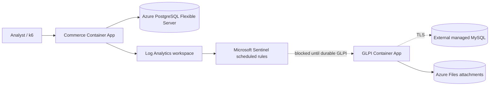

# SOC lab architecture

The commerce path is active. Sentinel and Log Analytics are active. GLPI and the external MySQL handoff remain disabled until a durable database endpoint is supplied and persistence is proven.
